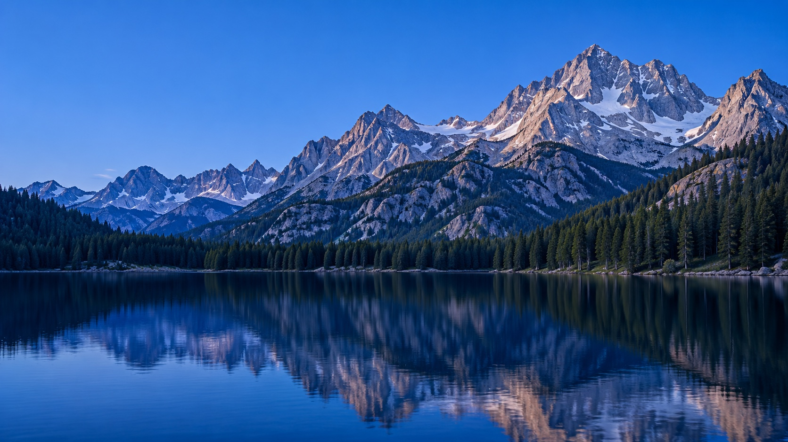
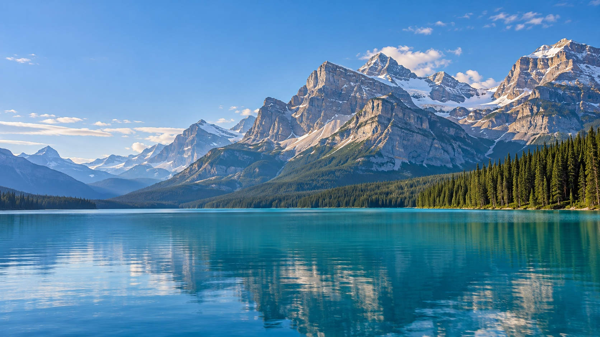
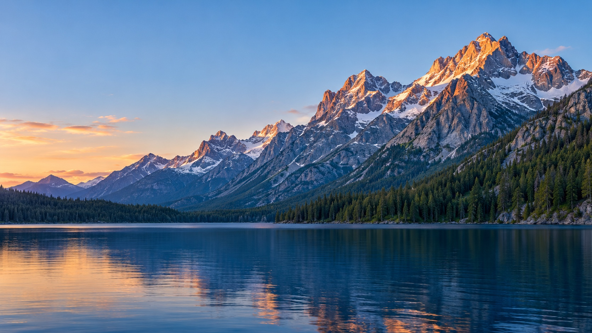
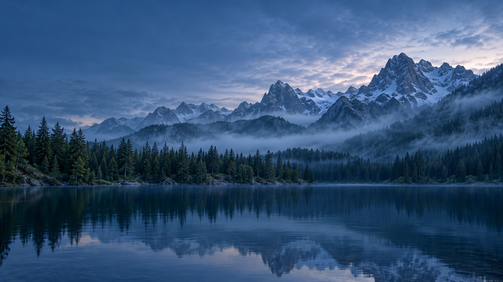
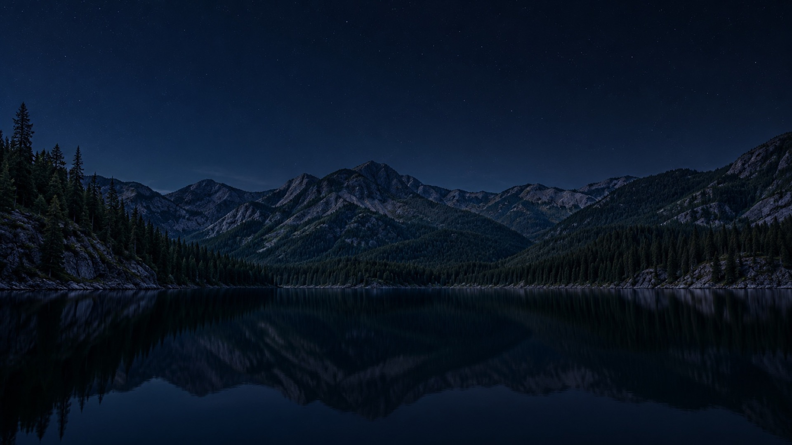

# Glasshouse Wallpapers

Cinq fonds d’écran générés par IA pour un accueil Glasshouse : lacs alpins, montagnes et forêt, avec un fond dédié au mode sombre.

Les fichiers JPEG sont les images utilisées pour cet accueil. Les paysages sont synthétiques et ne représentent pas nécessairement des lieux réels.

| Fond | Téléchargement direct |
| --- | --- |
| Lac alpin bleu | [01-lac-alpin-bleu.jpg](https://raw.githubusercontent.com/pducharme/glasshouse-wallpapers/main/01-lac-alpin-bleu.jpg) |
| Lac turquoise des Rocheuses | [02-rockies-turquoise.jpg](https://raw.githubusercontent.com/pducharme/glasshouse-wallpapers/main/02-rockies-turquoise.jpg) |
| Lac au soleil doux | [03-lac-soleil-doux.jpg](https://raw.githubusercontent.com/pducharme/glasshouse-wallpapers/main/03-lac-soleil-doux.jpg) |
| Forêt et brume bleue | [04-foret-brume-bleue.jpg](https://raw.githubusercontent.com/pducharme/glasshouse-wallpapers/main/04-foret-brume-bleue.jpg) |
| Lac de nuit | [05-lac-nuit.jpg](https://raw.githubusercontent.com/pducharme/glasshouse-wallpapers/main/05-lac-nuit.jpg) |

## Aperçus

### Lac alpin bleu

### Lac turquoise des Rocheuses

### Lac au soleil doux

### Forêt et brume bleue

### Lac de nuit

