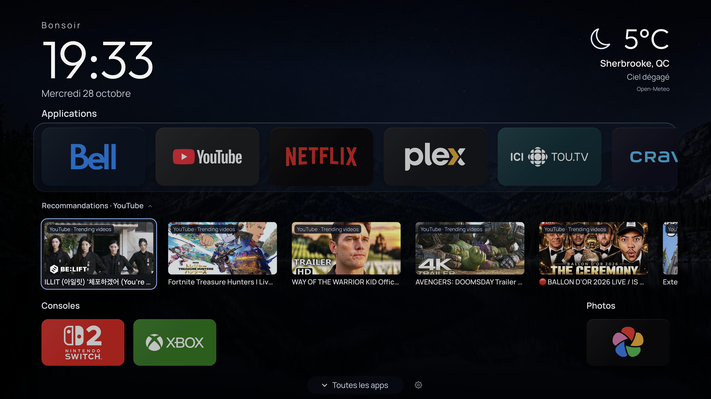
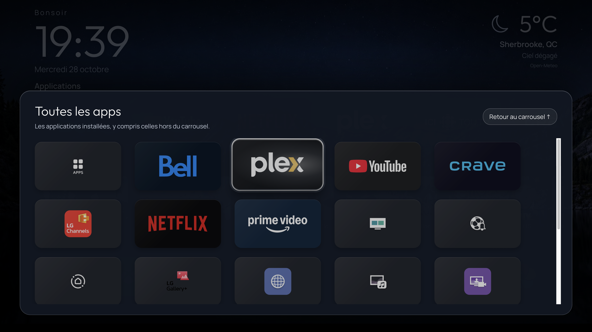
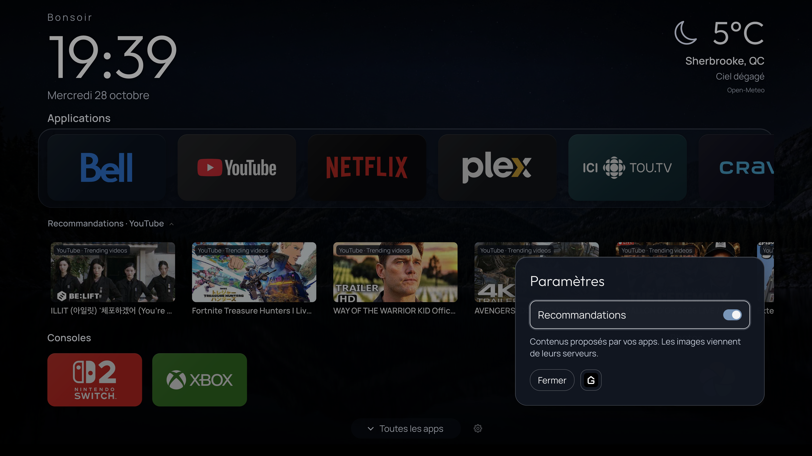

# Glasshouse Custom Home

**Un accueil personnalisé pour LG webOS · A custom home screen for LG webOS**

[Français](#français) · [English](#english) · [Documentation](docs/README.md) · [Upstream Glasshouse](https://github.com/rorygallagher2024/glasshouse)



| Toutes les apps / All apps | Paramètres compacts / Compact settings |
| --- | --- |
|  |  |

*Captures du 28 octobre 2026 : page réelle servie par une C6 sous Glasshouse 0.130.0, affichée dans un navigateur, et non capture de la dalle ou démo synthétique. / Captured October 28, 2026: the actual page served by a C6 running Glasshouse 0.130.0, rendered in a browser—not a panel capture or the synthetic demo.*

## Français

Glasshouse Custom Home est une personnalisation communautaire de l’accueil [Glasshouse](https://github.com/rorygallagher2024/glasshouse) pour une LG webOS déjà rootée. Le projet réunit l’interface, les sources serveur, un bundle de personnalisation reproductible, les tests et les guides pour l’adapter à votre propre télé. Il n’est affilié ni à LG ni aux services représentés.

### Ce que l’accueil apporte

- Carrousel d’applications favorites, rangée Consoles, tiroir **Toutes les apps** et réorganisation par appui long sur OK.
- Accordéon **Recommandations** lié à l’application sélectionnée; aucune carte inventée si le fournisseur n’en propose pas.
- Petit panneau de paramètres : activation des recommandations, fermeture et raccourci **G** vers Glasshouse.
- Fonds quotidiens, mode sombre de 17 h à 6 h, météo optionnelle et lanceur Photos facultatif pour un client Immich déjà installé.

La démo et les exemples sont assainis : météo fictive, recommandations désactivées et Photos non configuré. Les tuiles publiques utilisent des libellés typographiques ou les icônes natives disponibles sur la TV; les logos privés visibles dans les captures ne sont pas fournis comme fichiers réutilisables.

### Compatibilité et installation

La base publiée est **Glasshouse 0.130.0**, commit amont `1543769cfeb28c3ce0936dc6d20b24cd58c70255`. La variante a été vérifiée sur une C6; cela ne certifie pas les autres modèles, versions de webOS ou versions futures de Glasshouse. Aucune compatibilité Titan ou Lightkeeper n’est annoncée.

1. Essayez la [démo locale](#démo-locale--local-demo), sans télévision ni agent IA.
2. Suivez le [guide manuel](docs/MANUAL_GUIDE.md) pour vérifier votre modèle, le root existant, Node sur la TV et votre accès de maintenance. Le Developer Mode seul ne suffit pas au remplacement de HOME.
3. Sauvegardez votre installation et vos réglages **dans un emplacement privé**; préservez aussi `.previous`. Ne remplacez jamais une configuration réelle par un exemple.
4. Préparez et testez votre adaptation avant tout déploiement. L’installateur TV écrit des fichiers, installe par défaut un hook de démarrage et relance le serveur; la démo ne fait rien de cela.
5. Vérifiez le menu après installation et gardez le [parcours de retour arrière](docs/MANUAL_GUIDE.md) accessible avant une mise à jour.

Le [bundle de persistance](personalisation/README.md) peut réappliquer une personnalisation sur une version compatible. Il ne garantit pas la compatibilité de toutes les mises à jour. Ce dépôt ne livre pas un service de mise à jour nocturne prêt à l’emploi; la maintenance privée du propriétaire est distincte et son activation complète reste en attente d’un essai réel. Les recommandations ne garantissent ni reprise de lecture, ni progression, ni personnalisation universelle.

Pour un accompagnement facultatif, utilisez les [prompts Claude / Codex](docs/AI_PROMPTS.md). Les guides détaillés sont actuellement en français; ils ne contiennent aucun accès personnel à réutiliser.

## English

Glasshouse Custom Home is a community customization of [Glasshouse](https://github.com/rorygallagher2024/glasshouse) Home for an already rooted LG webOS TV. It includes the interface, server sources, a reproducible customization bundle, tests and guides for adapting it to your own TV. It is not affiliated with LG or the services shown.

### Home screen features

- Favorite-app carousel, console row, **All apps** drawer and long-press OK tile reordering.
- A **Recommendations** accordion scoped to the selected app; no fabricated cards when a provider supplies none.
- Compact settings with a recommendations toggle, Close button and **G** shortcut to Glasshouse.
- Daily wallpapers, dark mode from 17:00 to 06:00, optional weather and an optional Photos launcher for an already installed Immich client.

The public demo and examples are sanitized: synthetic weather, recommendations disabled and Photos unconfigured. Public tiles use text labels or native TV app icons where available. Private logos visible in screenshots are not included as reusable asset files.

### Compatibility and installation

The published baseline is **Glasshouse 0.130.0**, upstream commit `1543769cfeb28c3ce0936dc6d20b24cd58c70255`. This variant was verified on a C6; other models, webOS versions and future Glasshouse releases are not certified. No Titan or Lightkeeper compatibility is claimed.

1. Start with the [local demo](#démo-locale--local-demo). No TV or AI agent is required.
2. Follow the [manual guide](docs/MANUAL_GUIDE.md), currently in French, to check your model, existing root access, on-TV Node runtime and your own maintenance connection. Developer Mode alone does not provide the privileges required to replace HOME.
3. Back up the existing installation and settings **privately**, including `.previous`. Never overwrite real settings with an example configuration.
4. Prepare and test your adaptation before deployment. The TV installer writes files, installs a startup hook by default and restarts the server; the demo does none of these things.
5. Verify the result and keep the manual guide’s rollback procedure available before upgrading.

The optional [persistence bundle](personalisation/README.md) can reapply the customization to compatible versions. It cannot guarantee every future upgrade. This repository does not ship a ready-to-use nightly updater; the owner’s private maintenance setup is separate and still awaits a live activation test. Recommendations do not guarantee resume playback, progress tracking or universal personalization.

Optional [Claude / Codex prompts](docs/AI_PROMPTS.md) can help with assessment and preparation. Detailed guides are currently in French and contain no personal credentials to reuse.

## Démo locale / Local demo

**Git + Node.js 22+**. Aucun paquet npm nécessaire à la démo. / No npm packages are needed for the demo.

```sh
git clone https://github.com/pducharme/glasshouse-wallpapers.git glasshouse-custom-home
cd glasshouse-custom-home
git rev-parse HEAD
test -f glasshouse/package.json
npm --prefix glasshouse run demo -- --port 8766
```

Ouvrez / Open `http://127.0.0.1:8766/`. Le serveur reste sur la boucle locale, sans contacter de TV ou de service externe. / The server stays on loopback and contacts no TV or external service.

Flèches / arrows · Entrée / Enter = OK · Appui long / long press = déplacer / reorder · Échap / Escape = retour / back. `?hour=12` et / and `?hour=19` montrent les variantes jour et nuit / preview day and night. `Ctrl+C` arrête la démo / stops the demo. Notez le SHA avant d’adapter une TV / Record the SHA before adapting a TV.

## Organisation / Project map

| Chemin / Path | Contenu / Contents |
| --- | --- |
| [`glasshouse/`](glasshouse/) | Sources serveur, interface et tests / Server, interface and tests |
| [`personalisation/`](personalisation/) | Patches reproductibles et garde facultative / Reproducible patches and optional guard |
| [`docs/`](docs/README.md) | Installation, compatibilité, restauration, provenance / Installation, compatibility, recovery, provenance |
| [`examples/`](examples/) | Configuration synthétique à adapter / Synthetic settings to adapt |
| [`scripts/validate.sh`](scripts/validate.sh) | Vérifications locales et CI / Local and CI checks |
| [`docs/images/`](docs/images/) | Captures documentaires réelles / Actual documentation screenshots |

Les cinq fonds à la racine sont des paysages générés par IA / The five root-level wallpapers are AI-generated landscapes: [bleu / blue](01-lac-alpin-bleu.jpg), [turquoise](02-rockies-turquoise.jpg), [soleil / sun](03-lac-soleil-doux.jpg), [brume / mist](04-foret-brume-bleue.jpg), [nuit / night](05-lac-nuit.jpg). Leurs chemins sont conservés pour les références existantes / Their paths are preserved for existing references.

## Développement / Development

Node.js 22+, Python 3, `diff` et / and `patch`:

```sh
npm ci --prefix glasshouse --ignore-scripts --no-audit --no-fund
sh scripts/validate.sh
```

Types, tests, ES5, contrôles UI, bundle et assemblage du paquet sont vérifiés; la CI analyse aussi les secrets de l’arbre et de l’historique. / Checks cover types, tests, ES5, UI consistency, the customization bundle and package staging; CI also scans the tree and history for secrets.

Consultez / See [Contribuer / Contributing](CONTRIBUTING.md). Gardez réglages réels, photos personnelles, sauvegardes, journaux, clés et tokens hors des issues et commits. / Keep real settings, personal photos, backups, logs, keys and tokens out of issues and commits.

## Licences et crédits / Licenses and credits

- Glasshouse : [MIT upstream](glasshouse/LICENSE), Rory Gallagher; notices conservées / notices preserved.
- Polices / fonts : Outfit et / and Manrope, SIL OFL 1.1, notices incluses / included notices.
- Logo Immich : asset distinct sous AGPL-3.0, avec [licence et attribution](glasshouse/server/assets/third-party/immich/NOTICE.txt) / separate AGPL-3.0 asset with its license and attribution.
- Météo / weather : Open-Meteo, attribution dans le widget / attribution in the widget.
- Marques, icônes et images des services dans les captures appartiennent à leurs titulaires; aucune affiliation ou licence de marque implicite / Service marks, icons and images in screenshots belong to their owners; no affiliation or implied trademark license.

Voir la [provenance détaillée](docs/PROVENANCE.md) / See the detailed provenance. Aucune nouvelle licence globale n’est appliquée aux fonds ou au dépôt / No new blanket license is applied to the wallpapers or repository.
